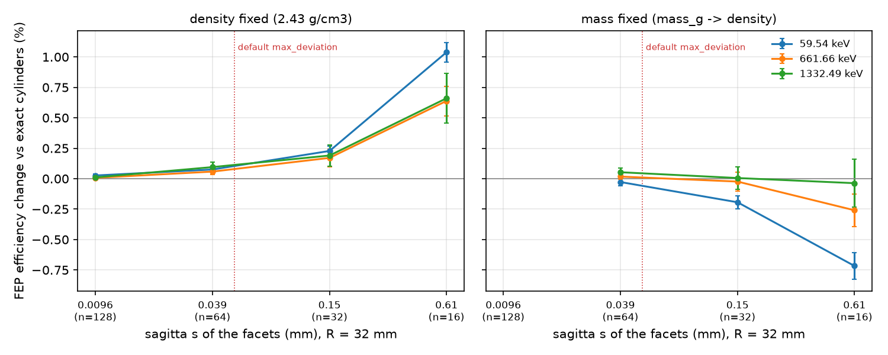
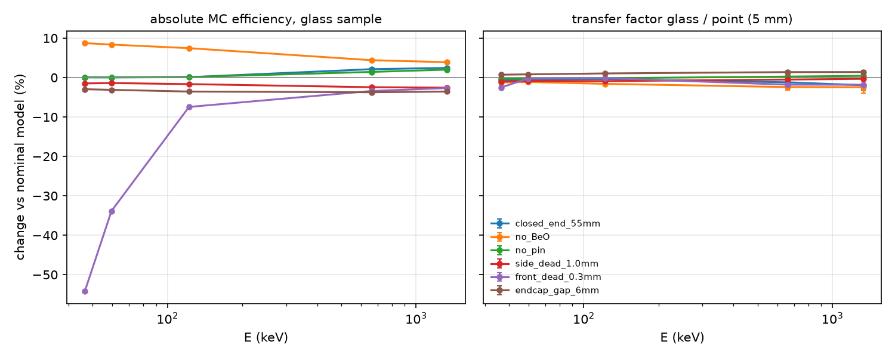

# Validation

All runs: OpenMC 0.15.2 built from source, ENDF/B-VII.1 HDF5 photon data (the same version and
library as yours), detector and samples of `examples/demo_detector2.yaml` (your detector #2,
glass in the PMMA cup on the end cap, point-source reference 5 mm above it). 10⁶–2·10⁶
histories per point unless stated; uncertainties are 1σ statistical.

DAGMC could not be built in this environment (its MOAB dependency could not be downloaded), so
the STL route was exercised up to the DAGMC file and the OpenMC model export, not transported.
The *physics* of triangulation was measured instead inside exact CSG (§3), which isolates the
faceting effect from DAGMC's numerical robustness.

## 1. Independent cross-check: Moens effective solid angle vs full Monte Carlo

Transfer factor glass/point computed two ways: full transport (OpenMC) and the Moens
effective-solid-angle integral evaluated by exact ray–cylinder intersections with no transport
and no OpenMC geometry (THEORY.md §4). They share only the configuration file and the cross
sections.

| E (keV) | transfer, Monte Carlo | transfer, Moens ESA | MC / ESA | virtual P/T sample / reference |
|---:|---:|---:|---:|---:|
| 46.54 | 0.1084 ± 0.0007 | 0.1089 | 0.996 | 0.968 / 0.972 |
| 59.54 | 0.1402 ± 0.0008 | 0.1409 | 0.995 | 0.971 / 0.975 |
| 88.03 | 0.1727 ± 0.0009 | 0.1734 | 0.996 | 0.961 / 0.965 |
| 122.06 | 0.1893 ± 0.0010 | 0.1906 | 0.993 | 0.923 / 0.929 |
| 165.86 | 0.2038 ± 0.0011 | 0.2058 | 0.990 | 0.842 / 0.850 |
| 279.20 | 0.2289 ± 0.0015 | 0.2318 | 0.987 | 0.621 / 0.629 |
| 661.66 | 0.2755 ± 0.0026 | 0.2750 | 1.002 | 0.343 / 0.342 |
| 898.04 | 0.2908 ± 0.0030 | 0.2908 | 1.000 | 0.286 / 0.286 |
| 1173.23 | 0.3059 ± 0.0034 | 0.3048 | 1.004 | 0.249 / 0.248 |
| 1332.49 | 0.3139 ± 0.0037 | 0.3113 | 1.008 | 0.233 / 0.231 |
| 1836.06 | 0.3347 ± 0.0044 | 0.3270 | 1.024 | 0.198 / 0.193 |

From 46 keV to 1.3 MeV the two agree within 1.3 %; at 1.8 MeV within 2.4 %. That residual is the
accuracy of Moens' assumption that the "virtual peak-to-total" is the same for both geometries
(he quotes a few per cent): the virtual P/T values in the last column differ by the same
amount. Positions, units, materials, densities and source sampling are therefore consistent
between two unrelated calculations — and the ESA transfer alone would already meet a 5 %
target for this sample.

## 2. STEP → exact CSG (GEOUNED) vs built-in CSG

The same cup and glass sample drawn in FreeCAD, exported as STEP and converted by GEOUNED
1.6.4, against the built-in `cup` + `fill` description (2·10⁶ histories each, different seeds):

| E (keV) | built-in CSG | STEP → GEOUNED CSG | STEP / CSG |
|---:|---:|---:|---:|
| 46.54 | 0.02344 | 0.02347 | 1.0011 ± 0.0065 |
| 59.54 | 0.03281 | 0.03282 | 1.0004 ± 0.0054 |
| 122.06 | 0.04103 | 0.04105 | 1.0005 ± 0.0048 |
| 661.66 | 0.01478 | 0.01468 | 0.9933 ± 0.0081 |
| 1332.49 | 0.00949 | 0.00948 | 0.9983 ± 0.0102 |

Identical within statistics. Converted cell volumes matched the CAD volumes (13.631 and
160.850 cm³) within the sampling uncertainty. Found and fixed while testing: GEOUNED writes a
`vacuum` boundary on its last surface — here the inner wall of the cup — which would have
killed every photon crossing it; the importer now resets all boundaries and renumbers surfaces
(unit test `test_geouned_xml_is_sanitised`).

## 3. Triangles ("FED"): how much faceting changes the efficiency

Cup and glass cylinders replaced by inscribed regular n-gons — exactly what an STL export does —
everything else unchanged. "density fixed": the faceted sample simply contains less glass;
"mass fixed": `mass_g` sets density = 390.864 g / faceted volume (what the STL route does).

Correlated sampling: every configuration (including the exact reference) samples the source by
the same rejection scheme with the same seed, so each history follows the same random numbers
until the changed geometry makes it diverge; the uncertainty is that of the batch-by-batch
differences (2·10⁶ histories, 20 batches). A first, uncorrelated version of this study could not
resolve effects below ~1.5 % — the paired design resolves 0.02 %.

| facets n | sagitta s (mm) | volume deficit | 59.54 keV | 661.66 keV | 1332.49 keV |
|---|---:|---:|---:|---:|---:|
| 16 (density fixed) | 0.615 | 2.55 % | +1.04 ± 0.08 % | +0.64 ± 0.12 % | +0.66 ± 0.20 % |
| 32 (density fixed) | 0.154 | 0.64 % | +0.23 ± 0.04 % | +0.17 ± 0.07 % | +0.19 ± 0.09 % |
| 64 (density fixed) | 0.039 | 0.16 % | +0.08 ± 0.02 % | +0.06 ± 0.03 % | +0.10 ± 0.04 % |
| 128 (density fixed) | 0.010 | 0.04 % | +0.03 ± 0.01 % | +0.01 ± 0.01 % | +0.01 ± 0.01 % |
| 16 (mass fixed) | 0.615 | 2.55 % | -0.72 ± 0.11 % | -0.26 ± 0.13 % | -0.04 ± 0.20 % |
| 32 (mass fixed) | 0.154 | 0.64 % | -0.19 ± 0.05 % | -0.02 ± 0.08 % | +0.01 ± 0.09 % |
| 64 (mass fixed) | 0.039 | 0.16 % | -0.03 ± 0.03 % | +0.02 ± 0.02 % | +0.05 ± 0.03 % |

The effect scales with the volume deficit (∝ 1/n²): about +0.4 × deficit with the density
fixed (less glass, less self-absorption, emitters closer to the axis) and about −0.3 × deficit
with the mass fixed (slightly denser glass) at 59.5 keV, less at high energy. Even a coarse
export with 0.6 mm chords changes the efficiency by ≤ 1 %; at the default `max_deviation` of
0.05 mm (n ≥ 57 for R = 32 mm) the change is below 0.1 % — negligible against a 5 % budget.
Triangles therefore do not break an FEP efficiency through faceting; what breaks DAGMC models is
mesh topology (leaks, non-matching shared surfaces), which the STL route rejects or flags.

Runtime is the other cost: 2·10⁶ histories took 17 s with exact cylinders and ~240 s with the
same geometry as 64-facet polygons in CSG (every plane is tested at every step; the 128-facet
mass-fixed case was skipped for this reason). DAGMC's bounding-volume hierarchy avoids that
scaling; exact surfaces avoid it altogether.

The mesh-only estimator (THEORY.md §5) against the exact values of FreeCAD exports:

| mesh | estimated chord deviation | estimated volume deficit | true deficit |
|---|---:|---:|---:|
| glass sample, 0.5 mm deflection (100 triangles) | 0.233 mm | 0.979 % | 0.970 % |
| glass sample, 0.05 mm deflection (316 triangles) | 0.0247 mm | 0.103 % | 0.103 % |
| PMMA cup, 0.05 mm (640 triangles; convex + concave faces) | 0.0248 mm | 0.071 % | 0.070 % |

The 0.5 mm export is rejected by the default check (0.233 mm > 0.05 mm).

## 4. Definition of "full energy": exact deposition vs a finite window

FEP efficiency counted with a ±0.1 / 0.5 / 1 keV window, relative to exact full deposition
(±1 eV, the default):

| E (keV) | setup | ±0.1 keV vs exact | ±0.5 keV vs exact | ±1 keV vs exact | effect on transfer (±0.5 keV) |
|---:|---|---:|---:|---:|---:|
| 46.54 | point 5 mm | +0.17 % | +1.17 % | +2.29 % |  |
| 46.54 | glass | +0.61 % | +4.10 % | +8.74 % | +2.90 % |
| 59.54 | point 5 mm | +0.11 % | +0.77 % | +1.56 % |  |
| 59.54 | glass | +0.44 % | +3.14 % | +6.54 % | +2.35 % |
| 88.03 | point 5 mm | +0.05 % | +0.34 % | +0.72 % |  |
| 88.03 | glass | +0.22 % | +1.69 % | +3.64 % | +1.34 % |
| 122.06 | point 5 mm | +0.02 % | +0.17 % | +0.37 % |  |
| 122.06 | glass | +0.10 % | +0.90 % | +2.00 % | +0.73 % |
| 661.66 | point 5 mm | +0.00 % | +0.01 % | +0.01 % |  |
| 661.66 | glass | +0.00 % | +0.02 % | +0.07 % | +0.01 % |

A wider window adds photons that Compton-scattered by small angles before reaching the
crystal (THEORY.md §2). The effect is negligible at 662 keV but reaches several per cent below
~100 keV in the 50 mm glass column, and only partly cancels in the transfer (+2.9 % at
46.5 keV for ±0.5 keV). This is a real systematic for the low-energy lines, set by how the
peak areas are measured: the exact definition matches peak fits that put the small-angle
scatter tail into the background (step) function; if the fitted peak absorbs part of that
tail, set `peak_window_keV` to roughly FWHM/2 at those energies (≈ 0.3–0.4 keV for a typical
coaxial HPGe at 50–60 keV) and quote the difference between the two as an uncertainty
component.

## 5. Angular biasing (optional)

| setup | E (keV) | analog | angular bias (auto) | ratio |
|---|---:|---:|---:|---:|
| reference_point_5mm | 59.54 | 0.23318 | 0.23309 (f = 0.375) | 0.9996 ± 0.0014 |
| reference_point_5mm | 661.66 | 0.05309 | 0.05306 (f = 0.375) | 0.9994 ± 0.0035 |
| glass_in_pmma_cup | 59.54 | 0.03277 | 0.03269 (f = 0.470) | 0.9975 ± 0.0046 |
| glass_in_pmma_cup | 661.66 | 0.01477 | 0.01473 (f = 0.470) | 0.9974 ± 0.0070 |

## 6. Detector-model assumptions: absolute efficiency vs transfer factor

One parameter changed at a time from the nominal model in `demo_detector2.yaml`, with the same
random-number streams for nominal and variant (correlated sampling); uncertainties come from
batch-by-batch differences, which is why they are much smaller than the statistical
uncertainty of either efficiency.

| variant | E (keV) | point source, absolute | glass sample, absolute | transfer factor |
|---|---:|---:|---:|---:|
| closed_end_55mm | 46.54 | +0.67 ± 0.03 % | +0.04 ± 0.04 % | -0.62 ± 0.05 % |
| closed_end_55mm | 59.54 | +0.63 ± 0.03 % | +0.04 ± 0.03 % | -0.59 ± 0.04 % |
| closed_end_55mm | 122.06 | +0.49 ± 0.03 % | +0.10 ± 0.04 % | -0.39 ± 0.05 % |
| closed_end_55mm | 661.66 | +3.37 ± 0.37 % | +2.12 ± 0.61 % | -1.20 ± 0.86 % |
| closed_end_55mm | 1332.49 | +4.48 ± 0.68 % | +2.45 ± 0.95 % | -1.95 ± 1.24 % |
| no_BeO | 46.54 | +10.11 ± 0.08 % | +8.74 ± 0.19 % | -1.25 ± 0.18 % |
| no_BeO | 59.54 | +9.60 ± 0.07 % | +8.37 ± 0.14 % | -1.12 ± 0.13 % |
| no_BeO | 122.06 | +9.20 ± 0.12 % | +7.46 ± 0.20 % | -1.60 ± 0.21 % |
| no_BeO | 661.66 | +6.98 ± 0.49 % | +4.40 ± 0.83 % | -2.41 ± 0.80 % |
| no_BeO | 1332.49 | +6.49 ± 0.61 % | +3.89 ± 1.20 % | -2.44 ± 1.49 % |
| no_pin | 46.54 | +0.37 ± 0.01 % | +0.07 ± 0.02 % | -0.30 ± 0.02 % |
| no_pin | 59.54 | +0.34 ± 0.01 % | +0.05 ± 0.01 % | -0.28 ± 0.02 % |
| no_pin | 122.06 | +0.30 ± 0.01 % | +0.13 ± 0.02 % | -0.16 ± 0.02 % |
| no_pin | 661.66 | +1.18 ± 0.06 % | +1.43 ± 0.13 % | +0.25 ± 0.14 % |
| no_pin | 1332.49 | +1.57 ± 0.10 % | +2.02 ± 0.23 % | +0.44 ± 0.27 % |
| side_dead_1.0mm | 46.54 | -0.49 ± 0.02 % | -1.49 ± 0.07 % | -1.00 ± 0.08 % |
| side_dead_1.0mm | 59.54 | -0.55 ± 0.01 % | -1.40 ± 0.08 % | -0.85 ± 0.08 % |
| side_dead_1.0mm | 122.06 | -0.76 ± 0.02 % | -1.66 ± 0.07 % | -0.91 ± 0.06 % |
| side_dead_1.0mm | 661.66 | -1.95 ± 0.05 % | -2.45 ± 0.13 % | -0.50 ± 0.13 % |
| side_dead_1.0mm | 1332.49 | -2.26 ± 0.08 % | -2.57 ± 0.19 % | -0.32 ± 0.22 % |
| front_dead_0.3mm | 46.54 | -52.98 ± 0.19 % | -54.16 ± 0.40 % | -2.51 ± 0.42 % |
| front_dead_0.3mm | 59.54 | -33.68 ± 0.14 % | -33.84 ± 0.22 % | -0.24 ± 0.31 % |
| front_dead_0.3mm | 122.06 | -7.32 ± 0.07 % | -7.45 ± 0.21 % | -0.14 ± 0.24 % |
| front_dead_0.3mm | 661.66 | -1.63 ± 0.41 % | -3.41 ± 0.65 % | -1.81 ± 0.76 % |
| front_dead_0.3mm | 1332.49 | -0.86 ± 0.59 % | -2.67 ± 1.02 % | -1.82 ± 1.27 % |
| endcap_gap_6mm | 46.54 | -3.66 ± 0.05 % | -2.96 ± 0.15 % | +0.73 ± 0.15 % |
| endcap_gap_6mm | 59.54 | -3.89 ± 0.03 % | -3.12 ± 0.10 % | +0.81 ± 0.11 % |
| endcap_gap_6mm | 122.06 | -4.55 ± 0.05 % | -3.55 ± 0.10 % | +1.05 ± 0.11 % |
| endcap_gap_6mm | 661.66 | -5.05 ± 0.13 % | -3.73 ± 0.27 % | +1.39 ± 0.26 % |
| endcap_gap_6mm | 1332.49 | -4.88 ± 0.14 % | -3.55 ± 0.34 % | +1.40 ± 0.40 % |

Compare the glass column (what an absolute Monte Carlo result would be off by) with the
transfer column (what the transferred result is off by). For the parameters with large effects
the transfer helps by factors of 1.5 to over 100: a 0.3 mm front dead layer (the spec says
none) removes 53 % of the absolute efficiency at 46.5 keV but changes the transferred value by
2.5 %; a 1 mm error in the crystal-to-end-cap distance moves the absolute efficiency by 3–4 % and
the transferred one by 0.7–1.4 %; leaving out the BeO window changes them by 4–9 % and 1.1–2.4 %.
The transfer does not help for details that matter only to the on-axis reference source: the
core bore and the pin change the point-source efficiency at low energy by 0.3–0.7 % while
hardly touching the glass sample, so that difference enters the transferred result instead of
cancelling — small, but it is why the bore geometry still matters.

For your open spec-sheet questions the transferred efficiency of the glass sample moves by:
closed-end instead of true coaxial 0.4–2 % (largest at high energy), the 0.8 mm BeO window
1.1–2.4 % (mostly because it sets the crystal 0.8 mm further from the end cap), the contact pin
≤ 0.4 %. Adding a ±1 mm crystal-position and a +0.3 mm side-dead-layer allowance, all in
quadrature with a 2 % reference uncertainty and the Monte Carlo statistics, gives about 2.8 % at
46.5 keV, 2.7 % at 59.5 keV, 3.8 % at 662 keV and 4.2 % at 1332 keV (the peak-definition term of
§4 comes on top at the lowest energies). That fits a 5 % budget, but the BeO / crystal-position
question is the one most worth settling with the manufacturer.

## 7. Statistics and transport integrity

167 runs (20 batches each): batch/binomial uncertainty ratio mean 0.984, standard deviation 0.160 (expected spread for 20 batches ≈ 0.162). Across all validation runs: 0 lost particles, no overlapping cells, and no history
deposited more than the source energy.

## 8. Failure modes deliberately provoked

| mistake | caught by |
|---|---|
| cup pushed 1 mm into the end cap | sampled overlap 3.42 cm³ (exact π·3.3²·0.1 = 3.42 cm³) and OpenMC geometry debugging: "Overlapping cells detected" |
| STL exported with 0.5 mm deflection | rejected: 0.233 mm chords, 0.98 % volume deficit |
| GEOUNED vacuum boundary on an internal surface | removed on import (unit test) |
| contact pin radius 7.775 mm > 5.35 mm bore | error suggesting the value is a diameter |
| misspelt key (`heigth`) | rejected — unknown keys are errors |
| deposits above E + window (energy bookkeeping) | counted in every run; zero in all runs here |
| two-batch trigger stop | replaced OpenMC triggers by a pilot + top-up scheme decided from the binomial estimate |
